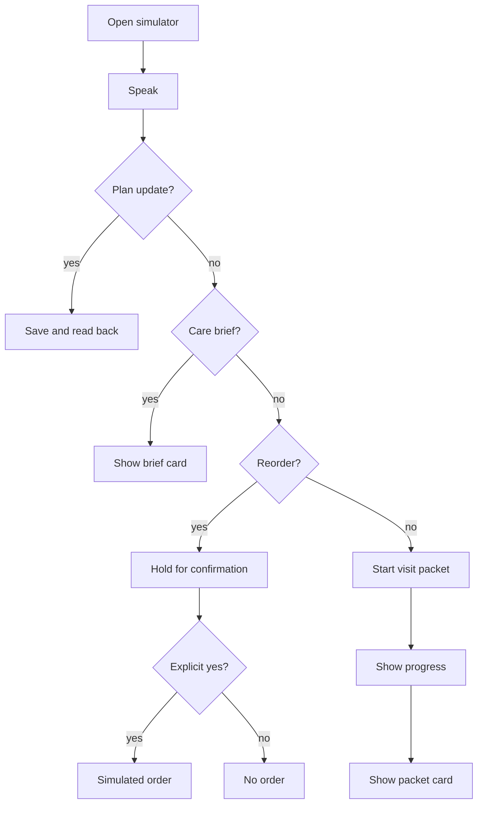

# Product Requirements (PRD)

**Project:** CareSync
**Date:** 2026-10-12
**Version:** 0.1
**Owner:** Gerald
**Status:** Draft
**Last reconciled:** N/A (not yet reconciled with reality)

---

## 1. Product Purpose & Value Proposition

CareSync answers one spoken question about a parent's day by joining adherence, the next appointment, and supply runway, then shows that answer on a card. It updates the plan from speech, prepares a reorder only after the caregiver confirms, and builds a visit packet in the background. The hackathon build uses a synthetic household and a simulated front end.

---

## 2. Target Personas

**Primary: Alex Rivera**: 41, working parent, coordinates weekday care for their mother. Pain: Thursday morning means three separate lists. Success: one question returns the missed dose, Thursday at 2, and the short supply, on one card.

**Secondary: the judging panel**: watches a recorded simulator session. Pain: cannot tell a single-turn bot from a coordinator. Success: two sessions prove memory, confirmation, and a finished packet.

---

## 3. Core Features & Priorities

IDs are permanent. Priority is MoSCoW.

| ID | Feature | Description | Priority |
|----|---------|-------------|----------|
| PRD-F1 | Care brief | New session answers "What's going on with Mom today?" from the stored plan: adherence, next appointment, supply runway, and one card | Must-Have |
| PRD-F2 | Spoken plan update | "Mom's cardiologist moved to Thursday at 2" updates the plan and reads the new time back | Must-Have |
| PRD-F3 | Supply runway and confirmed reorder | Warns when a supply is short and places a simulated reorder only after an explicit spoken or tapped yes | Must-Have |
| PRD-F4 | Visit Prep Packet | Long-running task: medication list, adherence, recent notes, questions for the doctor, with progress and a finished card | Must-Have |
| PRD-F5 | Scope policy | Rules so the agent cannot read or act outside the caregiver's household | Should-Have |
| PRD-F6 | Second surface | An Agent Skill beside the MCP server. In or out is [FILL] | Could-Have |
| PRD-F7 | Real checkout | Live payment or a live catalog order | Won't-Have |
| PRD-F8 | Live records | Insurer, pharmacy, or health-record APIs | Won't-Have |
| PRD-F9 | Appeal letters | Insurance appeal drafting | Won't-Have |

---

## 4. User Stories & Acceptance Criteria

**US-01: Care brief** (PRD-F1)

> As Alex, I want one answer about Mom today so that I do not open three lists.

- Given a stored plan from an earlier session, when Alex asks what is going on with Mom today, then the reply names adherence, the next appointment, and supply runway, and a card shows the same three facts.

**US-02: Move the visit** (PRD-F2)

> As Alex, I want to move the cardiologist by speaking so that the next session uses the new time.

- Given an existing cardiology appointment, when Alex says it moved to Thursday at 2, then the stored plan shows Thursday at 2 and the reply repeats that time.

**US-03: Reorder only after yes** (PRD-F3)

> As Alex, I want a reorder prepared and held so that nothing is bought by surprise.

- Given a short supply runway, when Alex asks to reorder and has not confirmed, then no simulated order exists.
- Given the confirmation card, when Alex says yes, then one simulated order is recorded and the reply says it was placed.

**US-04: Visit packet** (PRD-F4)

> As Alex, I want a packet before Thursday so that I am not rebuilding the medication list in the waiting room.

- Given a plan and a Thursday appointment, when Alex asks to get ready for Thursday, then a task starts, progress is visible, and the finished packet card lists meds, adherence, notes, and questions.

**US-05: Stay in household** (PRD-F5)

> As Alex, I want the agent limited to my household so that another household's plan is never read.

- Given two fixture households, when a request is scoped to household A, then household B is not returned.

---

## 5. App Flow & UX Intent

**Design reference:** [dsd-caresync.md](dsd-caresync.md). Exact visual tokens are [FILL].

### 5.1 Screen Inventory

| Screen | Purpose | Entry points | States to design |
|--------|---------|--------------|------------------|
| Simulator home | Speak or type, see the reply and the card | Open the web app | empty / loading / error / success |
| Confirmation card | Hold a reorder until yes or no | Reorder intent | empty / loading / error / success |
| Task progress | Show the visit packet while it runs | "Get me ready" | empty / loading / error / success |
| Packet card | Show the finished packet | Task completion | empty / loading / error / success |

### 5.2 Navigation Model & Information Architecture

**Primary navigation pattern:** one simulator page. Cards replace pages.

| Destination | Maps to screen (§5.1) | Route / path | Auth required | Feature(s) |
|-------------|-----------------------|--------------|---------------|------------|
| Home | Simulator home | / | No shared account in the demo. Household id is [FILL] | PRD-F1, PRD-F2 |
| Confirm | Confirmation card | / (card) | Same household scope | PRD-F3 |
| Packet | Task progress and packet card | / (card) | Same household scope | PRD-F4 |

```
/ simulator home
  card: care brief
  card: confirmation
  card: task progress
  card: visit packet
```

**Global elements, auth boundaries, deep links:** No public share link. Every tool call carries the fixture household id. A second household is refused.

### 5.3 App Flow

**Linear (primary path):** Open simulator, update the visit, later ask what is going on today, confirm a reorder, start the packet.



**Annotations:** entry is the simulator URL. Branches are update, brief, reorder, and packet. Dead ends: none. Closing the tab abandons an in-flight task; resume behavior is [FILL]. Edge cases: refused confirmation, model timeout, unknown household, duplicate reorder.

### 5.4 Onboarding Flow

Aha moment: the second session names Thursday at 2 without being told again. Time-to-first-value: the first scripted session. Skippable/resumable: there is no account wizard. Signup friction budget: none in the demo.

### 5.5 UX Constraints

- Voice in and voice out, with the same facts on a card.
- A reorder never completes on the first utterance.
- Empty state says the household has no plan yet. Loading state shows task progress for the packet. Error state says what failed and does not invent a dose or a time.

### 5.6 Instrumentation & Event Taxonomy

No business-metric sheet this cycle. Events exist so the demo can be reviewed. No names of real people in properties. Household id is the fixture id.

| Event name | Fires when | Key properties | Feeds metric |
|------------|-----------|----------------|--------------|
| `care_brief_shown` | Brief card renders | fixture household id, session id | Demo review |
| `plan_updated` | Spoken update is stored | field changed, session id | Demo review |
| `reorder_held` | Confirmation card shows | supply id | Demo review |
| `reorder_confirmed` | Explicit yes stored | supply id | Demo review |
| `visit_packet_finished` | Packet card renders | task id | Demo review |

**Naming convention:** snake_case, past tense where the event is a result. **Analytics tool:** [FILL]. Local demo log is enough for the hackathon.

---

## 6. Out of Scope for This Release

- Real checkout, live catalogs, and card numbers. Deferred past the hackathon.
- Live insurer, pharmacy, or health-record systems. Deferred past the hackathon.
- Appeal letters. Deferred past the hackathon.
- Production hosting, accounts, and a public deploy. Not this cycle.

---

## 7. AI / Agent Feature Specifications

- **AI component and model:** Care coordinator agent on Amazon Bedrock through Strands. Model id is [FILL] (Claude or Nova, not chosen).
- **Input to output:** Caregiver speech or text, plus the fixture plan, to a short spoken reply and a card payload. Latency target [FILL].
- **Human-in-the-loop points:** Explicit yes before any reorder. Plan changes are read back in the same turn. No medical advice.
- **Fallback when AI fails or is unavailable:** Say the plan could not be read, show the last stored card if one exists, and do not invent doses, times, or orders.
- **Token / cost budget per operation:** [FILL]. Effort to measure it is UNCALIBRATED.

---

## 8. Dependencies & Assumptions

- **Dependencies:** Self-hosted MCP server, Bedrock, cross-session memory, synthetic JSON fixtures, a web simulator. MCP Apps hosting is [FILL].
- **Assumptions:** A1 through A6 in [state.md](state.md). Research market figures are not requirements.

---

## 9. Implementation Plan

Effort for every row is UNCALIBRATED. No hour estimate is implied.

| # | Phase / Milestone | Entry criteria | Exit criteria (Definition of Done) | Owner (DRI) | Top risk |
|---|-------------------|----------------|-------------------------------------|-------------|----------|
| M1 | Docs | Direction note exists | This suite is Draft and the gate is PROCEED WITH FIXES | Gerald | Open choices left unmarked |
| M2 | Design | PRD Draft | Card content specified. Visual tokens may stay [FILL] | Gerald | MCP Apps versus cards still open |
| M3 | Development | Design noted | Must-Have stories pass on fixtures | Gerald | Spec and memory setup |
| M4 | Testing and QA | Feature-complete on fixtures | QAD rows pass on the simulator | Gerald | Prompt injection or a reorder without yes |
| M5 | Demo capture | QA passed on fixtures | Recorded session under the video limit | Gerald | Latency [FILL] |
| M6 | After submission | Hackathon closed | Decide whether any real data is ever in scope | Gerald | Scope creep into records or payments |

**Rollout strategy:** One demo environment. No phased production rollout, because there is no production host.

**Rollback plan:**

- *Trigger criteria:* A tool writes a second household, a reorder is stored without yes, or the reply invents a medication.
- *Revert mechanism:* Redeploy the previous demo revision and reload the synthetic fixtures. There is no production database migration in this cycle.

**RFC cross-reference:** N/A. The open architecture choices are [FILL], not a decision record.

---

## Self-Check

- [x] Every Must-Have has a permanent id and a story with Given/When/Then
- [x] Interactive screens name empty, loading, error, and success
- [x] Events cover the demo beats
- [x] AI section filled
- [x] Rollout and rollback stated
