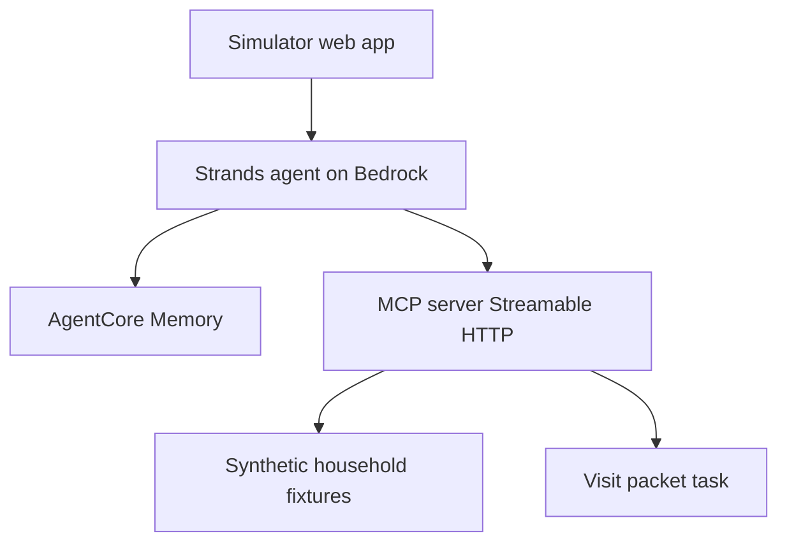
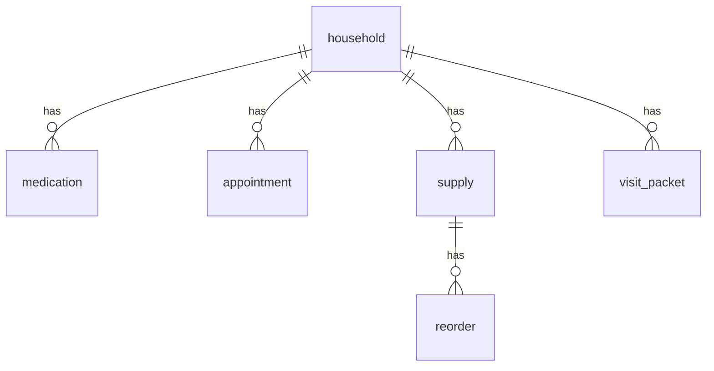
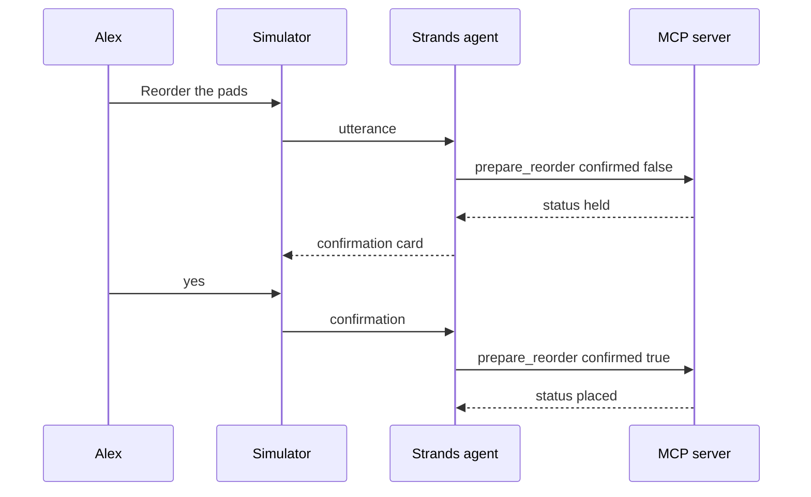

# System Design (SDD)

**Project:** CareSync
**Date:** 2026-10-12
**Version:** 0.1
**Owner:** Gerald
**Status:** Draft
**Last reconciled:** N/A (not yet reconciled with reality)

---

## 1. Architectural Vision & Principles

**Architecture style:** One self-hosted MCP server (Streamable HTTP) plus one agent process and a simulated web client. Fixtures stand in for the dispenser, the calendar, and the catalog.

**Guiding principles:** The server is the source of truth for the plan. The model never writes a reorder without a stored confirmation. Synthetic data only.

**Key trade-offs and known V1 debt:** JSON fixtures instead of a managed database. Memory product is Bedrock AgentCore Memory, with a local fixture fallback if setup slips. MCP Apps versus plain cards is [FILL]. Policy engine (Cedar) is Should-Have, not required for the demo.

---

## 2. High-Level Architecture



| Layer | Technology | Responsibility |
|-------|------------|----------------|
| Client | Simulated web app. Speech in and out is [FILL] (browser speech, or Polly and Transcribe) | Capture speech, render cards, send the confirmation |
| API / Gateway | MCP Streamable HTTP, spec 2026-07-28 with fallback 2025-11-25 | Tools and tasks |
| Service / Compute | Strands on Bedrock | Turn speech into tool calls and a short reply |
| Data | JSON fixtures plus AgentCore Memory | Household plan and cross-session facts |
| Infrastructure | [FILL] host for the demo | Run the server locally or on one demo box |

**Must-Have trace:**

| PRD-F# | Component(s) | Tables / endpoints |
|--------|--------------|--------------------|
| PRD-F1 | Agent, memory, MCP `get_care_brief` | `care_event`, `appointment`, `supply` |
| PRD-F2 | MCP plan write | `appointment` |
| PRD-F3 | MCP `get_supply_runway`, `prepare_reorder` | `supply`, `reorder` |
| PRD-F4 | MCP `start_visit_packet` task | `visit_packet` |

---

## 3. Data Architecture

**Primary database:** JSON fixture files for the hackathon, because there is one synthetic household and no production store. **Cache:** none. **Vector store:** N/A.

**Table: `household`**

| Column | Type | Null? | Default | Key / Index | Constraint |
|--------|------|-------|---------|-------------|------------|
| `id` | string | No | | PK | fixture id |
| `label` | string | No | | | synthetic display name |

**Table: `medication`**

| Column | Type | Null? | Default | Key / Index | Constraint |
|--------|------|-------|---------|-------------|------------|
| `id` | string | No | | PK | |
| `household_id` | string | No | | FK to household.id | |
| `name` | string | No | | | synthetic label |
| `adherence` | string | No | | | last known status |

**Table: `appointment`**

| Column | Type | Null? | Default | Key / Index | Constraint |
|--------|------|-------|---------|-------------|------------|
| `id` | string | No | | PK | |
| `household_id` | string | No | | FK to household.id | |
| `title` | string | No | | | |
| `when_text` | string | No | | | spoken time, not a guessed timezone |

**Table: `supply`**

| Column | Type | Null? | Default | Key / Index | Constraint |
|--------|------|-------|---------|-------------|------------|
| `id` | string | No | | PK | |
| `household_id` | string | No | | FK to household.id | |
| `name` | string | No | | | |
| `days_left` | number | No | | | |

**Table: `reorder`**

| Column | Type | Null? | Default | Key / Index | Constraint |
|--------|------|-------|---------|-------------|------------|
| `id` | string | No | | PK | |
| `supply_id` | string | No | | FK to supply.id | |
| `status` | string | No | held | | held or placed |
| `confirmed` | boolean | No | false | | true only after explicit yes |

**Table: `visit_packet`**

| Column | Type | Null? | Default | Key / Index | Constraint |
|--------|------|-------|---------|-------------|------------|
| `id` | string | No | | PK | |
| `household_id` | string | No | | FK to household.id | |
| `status` | string | No | running | | running or done |
| `body` | string | Yes | | | empty until done |

**Relationships:** household 1:N medication, appointment, supply, visit_packet. supply 1:N reorder.



**Indexes:** fixture files, no engine indexes. **Caching:** none.

**Migration strategy:** Replace fixture files. No production migration. A bad write is rolled back by restoring the fixture file.

---

## 4. API Design & External Integrations

**API style:** MCP tools over Streamable HTTP. **Contract source:** inline below.

| Method | Path | Purpose |
|--------|------|---------|
| POST | `/mcp` tool `get_care_brief` | Care brief for PRD-F1 |
| POST | `/mcp` tool `get_adherence` | Dose status for PRD-F1 |
| POST | `/mcp` tool `list_appointments` | Visits for PRD-F1 and PRD-F2 |
| POST | `/mcp` tool `update_appointment` | Spoken plan update for PRD-F2 |
| POST | `/mcp` tool `get_supply_runway` | Days remaining for PRD-F3 |
| POST | `/mcp` tool `prepare_reorder` | Hold or place a simulated reorder for PRD-F3 |
| POST | `/mcp` tool `start_visit_packet` | Start the task for PRD-F4 |

**Must-Have endpoint contracts:**

`POST /mcp` tool `get_care_brief` · PRD-F1

```
Request:
{ "household_id": "hh_demo" }

Response 200:
{ "adherence": "missed morning dose", "next_appointment": "Thursday at 2", "supply_runway": "pads, 4 days", "card": {} }
```

`POST /mcp` tool `prepare_reorder` · PRD-F3

```
Request:
{ "household_id": "hh_demo", "supply_id": "sup_pads", "confirmed": false }

Response 200:
{ "status": "held", "confirmed": false }
```

A second call with `"confirmed": true` is valid only when the caregiver yes is already stored. Otherwise the status stays held.

`POST /mcp` tool `start_visit_packet` · PRD-F4

```
Request:
{ "household_id": "hh_demo", "appointment_id": "appt_cardio" }

Response 200:
{ "task_id": "task_1", "status": "running" }
```

### 4.1 Runtime sequences



**External integrations:**

| Service | Purpose | Rate limits / fallback |
|---------|---------|------------------------|
| Amazon Bedrock | Model for the agent | On timeout, speak the failure and do not invent facts |
| AgentCore Memory | Cross-session plan facts | On setup failure, read the fixture file for the demo |
| Pill dispenser, calendar, catalog | None live | JSON fixtures only |

Card rendering (MCP Apps or plain cards) is [FILL]. The tool payloads stay the same either way.

---

## 5. Security & Authorization

- **Authentication:** Demo household id on each tool call. A real account system is [FILL]. No shared secret belongs in the repo.
- **Session:** Simulator session id plus AgentCore Memory for the plan. Expiry [FILL].
- **Authorization model:** Server checks household id on every tool. PRD-F5 (Cedar) is Should-Have and may be absent in the demo. Absent policy does not allow cross-household reads. The server check still applies.
- **PII at rest:** Synthetic fixtures only. **Secrets:** Bedrock access stays outside the repo. **Input validation:** Reject a tool call whose household id is not the fixture id.

---

## 6. Infrastructure, CI/CD & Deployment

- **Hosting:** [FILL]. Local demo is enough this cycle. **Environments:** one demo.
- **CI/CD:** [FILL]. Not required to write docs.
- **Backup and DR:** Fixture files in git. RTO and RPO are [FILL] because there is no production store. Restore is checkout of the fixture file.

---

## 7. Non-Functional Requirements

| Requirement | Target | Notes |
|-------------|--------|-------|
| API response (p95) | [FILL] | Tool handlers are fixture reads |
| Voice turn, end to end | [FILL] | Direction note says about 2.5 seconds. That number is not locked |
| AI stream first token | [FILL] | Model id is [FILL] |
| Uptime | Demo session only | No production SLO |
| Max concurrent users V1 | 1 caregiver in the recording | |
| Data retention | Synthetic fixtures until the repo changes them | No real subject |

---

## 8. AI / Agent Architecture

**AI approach:** One agent. It may call the MCP tools. It may not place a reorder unless `confirmed` is already true on the server.

| Agent / task | Model | Reason |
|--------------|-------|--------|
| Care coordinator | [FILL] on Bedrock | Claude or Nova. Not chosen |

- **Context:** System instructions, the current utterance, and tool results. Untrusted speech is labeled as the caregiver utterance, not as instructions.
- **Tools:** `get_care_brief`, `get_adherence`, `list_appointments`, `update_appointment`, `get_supply_runway`, `prepare_reorder`, `start_visit_packet`. Risk: `prepare_reorder` and `update_appointment` write. The rest read.
- **HITL gates:** `prepare_reorder` with `confirmed` true only after the caregiver's explicit yes. The server rejects a model-only confirmation.
- **Token / cost budget:** [FILL]. UNCALIBRATED.
- **Fallback:** One retry on transport failure. Then a spoken error. No silent extra tool calls.

### 8.1 AI Safety & Threat Surface

| Risk (OWASP Top 10 for LLM Applications, 2025) | Applies? | Control | Eval (QAD ref) |
|------------------|----------|---------|----------------|
| LLM01 Prompt injection (direct + indirect) | Yes | Utterance and fixture text are data. Tool names come from the server list, not from the utterance. | AI-04 |
| LLM05 Improper output handling | Yes | Card fields are text. The client does not treat model output as code. | AI-01 |
| LLM02 Sensitive-info disclosure | Yes | Only the fixture household is readable. | AI-06 |
| LLM06 Excessive agency / tool over-permissioning | Yes | Server rejects unconfirmed reorder. | AI-05 |
| Jailbreak / guardrail bypass | Yes | Medical advice and other-household reads are refused. | AI-07 |
| Hallucination causing user harm | Yes | Doses and times come from tool results. If tools fail, the reply says so. | AI-01 |

**Data sent to model providers:** The utterance and the fixture plan. Provider retention and training terms are [FILL]. Region is [FILL]. Reconcile with CLR §1 before any real subject.

**Trust boundary:** Caregiver speech, fixture text, and model output are untrusted. A tool runs only when the agent runtime selects a registered tool and the server validates the arguments.

### 8.2 AI craft

| Craft | Answer |
|-------|--------|
| **Prompt** | System rules, caregiver utterance, and tool results are separate blocks |
| **Context** | Window holds the current plan summary and the latest tool results. Fixture notes are labeled untrusted |
| **Harness / tools** | `prepare_reorder` cannot set confirmed by itself. No pay, delete, or privilege tool exists |
| **Loop** | Tool loop stops after the reply or after a small cap [FILL]. A reorder confirmation breaks the loop until the human answers |
| **Token / cost** | [FILL]. No kill switch until a budget exists |
| **Eval** | QAD AI-01 through AI-07 |

---

## Self-Check

- [x] Every Must-Have maps to a component
- [x] Diagram, typed tables, erDiagram, Request shapes, and sequenceDiagram are present
- [x] Auth, household check, secrets, and input validation are named
- [x] Unknowns stay [FILL]
